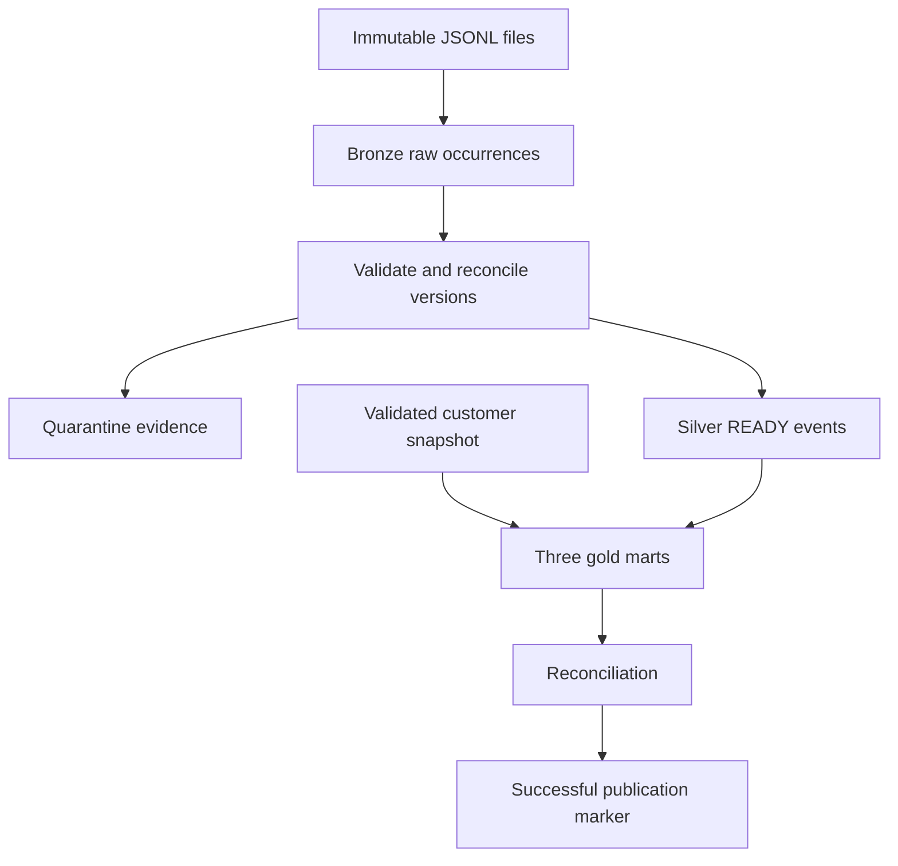

# Security Telemetry Lakehouse

Owner: Prudhvi Yalamanchili.

This repository builds a small analytics pipeline for synthetic endpoint telemetry. Product teams need to see whether a release lines up with more scan failures, which customer cohorts are active, and whether the telemetry is trustworthy enough to answer those questions. Raw events arrive as files. They can repeat, arrive late, or correct an earlier version.

Repository: https://github.com/prudhviy99/security-telemetry-lakehouse. A Databricks workspace run has not yet been recorded.

The local runtime is Apache Spark, Delta Lake, and Python. The separate Databricks adapter uses Auto Loader, Unity Catalog managed tables, and a deployable serverless Lakeflow job. Local execution and cloud execution are distinct validation targets. See [evidence](docs/evidence.md) for measured results and remaining workspace checks.

This is a small correctness-focused portfolio project. Validation and touched-event reconciliation collect data on the driver; the 105-row reference fixture and 10,000-event demo do not establish production-scale throughput.

## Architecture



Default namespace: `security_telemetry_demo`. Paths and the catalog name are configuration. Select `backend='databricks'` for named Unity Catalog managed tables and volume input/checkpoint paths. Local runs use path-based Delta tables under the warehouse directory. Databricks notebooks reuse the workspace Spark session; the local CLI starts its own JVM.

| Object | Grain | What it holds |
| --- | --- | --- |
| `bronze_events` | one raw line occurrence | `raw_json`, `source_file`, `loaded_at` |
| `quarantine_events` | raw payload hash + reason | evidence, reason, first-seen run |
| `silver_event_versions` | `(event_id, event_version, payload_hash)` | canonical payload and earliest receipt |
| `silver_current` | `event_id` | greatest valid version, state `READY` or `CONFLICT` |
| `silver_events` | `event_id` | READY rows only |
| `dim_customer` | `customer_id` | current plan, country, channel, signup month |
| `gold_device_day` | `(event_date, customer_id, device_id)` | accepted events, scans, failures, threats, duration, rate |
| `gold_product_version_day` | `(event_date, product_version)` | distinct active devices plus the same scan health |
| `gold_signup_cohort_day` | `(event_date, signup_month, plan_tier)` | distinct customers and devices plus scan health |
| `pipeline_stream_state` | stream kind within a target | stable identity, generation, checkpoint location and UUID |
| `pipeline_run_audit` | `(stream_id, batch_id, run_kind)` | batch completions and whole-job status |
| `successful_publication` | `publication_id` | written only after gold reconciliation passes |

`event_date` is the UTC date of `event_ts`. An active device is a distinct `(customer_id, device_id)` pair. A device that uses two product versions on one day is counted in each version. For a global distinct total, do not sum version-level active devices.

## Denominators

`scan_failure_rate = failed_scan_count / scan_count`, and the rate is null when scan_count is 0. Only scans are in the denominator. Average duration uses accepted scans only, and it is null when there are no accepted scans. Threat events are observations. They are not a count of protected customers or attacks prevented.

Signup month is a cohort label, not proof of retention or causality. Plan, country, and channel are the current customer snapshot, not the plan at event time. An event whose customer is missing from the snapshot stays in the event tables and receives `UNKNOWN` segment attributes. Duplicate customer ids block publication instead of multiplying events in a join.

These same rules are what the code, the tests, and this README implement.

## Reliability decisions

Silver is incremental. Bronze is append-only. A structured streaming query with `Trigger.AvailableNow` reads new files into bronze and, separately, new bronze rows into silver. Bronze and silver have different checkpoint directories, both outside the input directory. Source files are not modified. The orchestrator holds a single-run lock, matching a max concurrent run of one.

Inside each silver batch the code validates rows, canonicalizes the ones that pass, and MERGEs the version ledger. The same canonical payload keeps the earliest receipt time. For every `event_id` touched by the batch, current state is recomputed from all stored versions of that id, not from the micro-batch alone. The greatest version is `READY` when it has one canonical payload. Multiple payloads at that version become `CONFLICT` and drop out of `silver_events`. A later unambiguous higher version becomes `READY` again. Ledger, quarantine, and current-state writes are idempotent, so a failed batch can be resumed from the same checkpoint without duplicating rows. The batch audit row is written last. There is no transaction across those tables.

Gold is a full rebuild from the READY view, and only after silver succeeds. That is deliberate: a late event or a correction has to change the historical UTC day, including removing the old day's contribution. Rebuilding three tables is not atomic. The pipeline reconciles grains, the scan-rate rule, and the sum of device-day accepted events against READY silver before it advances `successful_publication`. The marker means reconciliation passed. It does not make the three gold tables appear at the same instant. An intentional gold assertion failure does not advance the marker. The marker also does not preserve the prior live gold snapshot after partial overwrites. See [retry and rebuild](docs/recovery.md) for checkpoint identity, upgrade, and safe isolated rebuild rules.

## Canonical payload

The hash covers `event_id`, `event_version`, `customer_id`, `device_id`, the UTC `event_ts`, `event_type`, `product_version`, `scan_status`, and `duration_ms`. It excludes receipt time and ingestion metadata, so the same business event can be delivered twice. Timestamps are normalized to `YYYY-MM-DDTHH:MM:SS.ffffffZ`. Null stays null. Numbers used in the hash are canonical decimals without an exponent and without trailing zeros (`10`, `10.0`, and `10.00` hash as `10`). The hash document is sorted JSON, hashed with SHA-256.

Input timestamps must carry `Z` or a numeric offset. The parser does not infer a timezone from the machine locale. An event more than five minutes ahead of its receipt is rejected. An old event is not rejected for being old. Event versions must fit a positive signed 64-bit integer. Scan durations must be nonnegative and representable as finite doubles. Invalid timezone offsets and UTC overflow are quarantined.

Optional `agent_build` is kept in the bronze raw line and is not part of the hash. A required field with the wrong type, or `schema_version` other than 1, is quarantined with a reason that names the field.

## Five-minute walkthrough

1. Create a virtualenv, install the project with the Spark extra, and generate the reference fixture. You should see 105 event lines and 12 customers.
2. Run the orchestrator. It ingests `data/events.jsonl`, validates, builds the three marts, and prints a `PIPELINE_SUMMARY` line. The reference fixture lands at 105 bronze rows, 100 READY logical events, and 3 basic invalid rows.
3. Open `quarantine_events`. Expect three validation reasons: a missing `event_id`, an unsupported event type, and an `event_ts` more than five minutes ahead of `received_ts`. Conflicts are a separate reason and are not part of those three rows.
4. Query `silver_events` and the gold tables. `event-0010` is timestamped `2026-06-02T03:30:00+05:00`, which is still 2026-06-01 in UTC. `event-0003` uses customer `cust-unknown` and shows up under `UNKNOWN` / `UNKNOWN` in the cohort mart. `event-0002` has a superseded version 1 and a READY version 2.
5. Run `sql/analysis.sql` with `analysis_params.as_of_date` set. The comments in that file are the tiny expected results, not the 105-row fixture. Read the rate beside the scan volume. Do not treat a higher rate as proof that a release caused it: the data is synthetic, and mix and volume can move a ratio.
6. Run `pytest`. Contract tests do not need Spark. The Spark tests replay batches, inject a failure after every silver sink, and check that a failed gold assertion leaves the publication marker where it was.

## Run locally

Use Python 3.12 and Java 21 for the pinned PySpark 4.2.0 / delta-spark 4.4.1 local runtime. On macOS with multiple JDKs, select Java 21 with `export JAVA_HOME="$(/usr/libexec/java_home -v 21)"`.

```bash
python3.12 -m venv .venv
source .venv/bin/activate
pip install -e ".[dev,spark]"
python -m telemetry.generate --scenario reference --out-dir data
python -m telemetry.orchestrator \
  --events data/events.jsonl \
  --customers data/customers.jsonl \
  --warehouse warehouse \
  --namespace security_telemetry_demo
```

Inspect quarantine and a mart:

```bash
python - <<'PY'
from pathlib import Path
from pyspark.sql import SparkSession
from delta import configure_spark_with_delta_pip
builder = SparkSession.builder.master("local[1]").appName("inspect")
builder = builder.config("spark.sql.extensions", "io.delta.sql.DeltaSparkSessionExtension")
builder = builder.config("spark.sql.catalog.spark_catalog", "org.apache.spark.sql.delta.catalog.DeltaCatalog")
spark = configure_spark_with_delta_pip(builder).getOrCreate()
root = Path("warehouse/security_telemetry_demo")
spark.read.format("delta").load(str(root / "quarantine_events")).select("quality_reason", "detail").show(truncate=False)
spark.read.format("delta").load(str(root / "gold_product_version_day")).orderBy("event_date", "product_version").show(20, truncate=False)
PY
```

Analysis SQL expects the current database to contain the pipeline tables and a one-row view:

```sql
CREATE OR REPLACE TEMP VIEW analysis_params AS SELECT DATE '2026-07-08' AS as_of_date;
```

The statements live in `sql/analysis.sql`. Point `as_of_date` at a day you care about. The expected-result comments are for the tiny fixture used by the tests, with that date set to 2026-07-08.

A larger deterministic set, for a rough local timing note rather than a throughput target:

```bash
python -m telemetry.generate --scenario volume --out-dir /tmp/telemetry-volume
python -m telemetry.measure --events /tmp/telemetry-volume/landing --customers /tmp/telemetry-volume/customers.jsonl
```

### Docker

`Dockerfile` and `docker-compose.yml` install the same pinned Spark and Delta versions and run the full test suite:

```bash
docker compose run --rm lakehouse-tests
```

### Tests

GitHub Actions has independent lightweight, Spark integration, and Docker smoke jobs. Each uploads test logs and a JUnit report for the tested commit. Lightweight tests:

```bash
pip install -e ".[dev]"
pytest -m "not spark" -q
```

Spark, Delta MERGE, checkpoints, and recovery:

```bash
pip install -e ".[dev,spark]"
pytest -m spark --require-spark-tests -q
```

The required-Spark flag fails when integration tests are absent or skipped. Run the complete suite with `pytest --require-spark-tests -q`.

## Databricks execution

[Databricks setup and acceptance](docs/databricks.md) describes Free Edition signup, workspace OAuth, dedicated schema/volume setup, input upload, bundle deployment, and real cloud checks.

- `databricks.yml` and `resources/telemetry.job.yml` define `telemetry_pipeline`: bronze, silver plus dimension, gold, then validation/publication. All four tasks use the same actual job run ID. Runs are limited to one at a time.
- `telemetry_acceptance` runs small Auto Loader/Delta checks in isolated demo schemas and writes a measured report. Silver failure injection is opt-in and disables injection before recovery.
- Notebook dependencies install this project's wheel without local PySpark/Delta extras. Managed runtime dependencies come from Databricks.
- Cloud inputs/checkpoints remain URI strings; output tables use qualified Unity Catalog names. No tables are registered under volumes.
- Workspace execution, permissions, and run IDs remain unverified until a real run succeeds. Local tests and a static bundle check do not establish cloud success.

`python -m telemetry.orchestrator --print-job` prints only the local function outline; deploy the actual bundle for a workspace job.

## Layout

Reference scenario: `scenarios/reference.json` (fixed seed, 105 raw rows, 100 READY events, 3 invalid rows). Extend behavior by adding a scenario file. Do not silently retune the reference fixture.

The optional anomaly or modeling extension in the build spec is not part of this repository.
